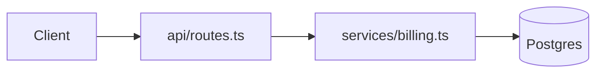

# Anatomy

What every README on GitHub has, and how to build each part. Every part adapts to the repo: take the values from its files, never from this page. Section names go in the README's language.

```text
Title and subtitle
Cover
Section links
GitHub data
──────────────
What it is
Usage
Installation
(sections of the project type)
Credits
License
```

The first four form the header, inside one `<div align="center">` (blank lines inside the `div` are needed for Markdown to render). The five fixed sections always appear, in this order, filled with real content. Type-specific sections go between Installation and Credits.

## 1. Title and subtitle

```markdown
# project-name

**The subtitle: one line that says what it does and what makes it different.**
```

- The title is the real name from the manifest or the repo, written as the author writes it.
- The subtitle is what makes a stranger keep reading. It names what the project does and the one thing that sets it apart: a constraint, a number, a contrast, a decision. One line, in bold or as plain text under the title.
- It must survive the portability test. If it fits another project, it is weak.

| Weak | Strong |
|---|---|
| A powerful and flexible design system | A design system in plain CSS: no framework, no build step for the people who use it |
| Fast JSON parser for modern apps | Parses a 40 MB JSON file in 0.8 s, with no dependencies |
| My AI agents | Agents that refuse to start until you tell them about your project |

- Every claim in it is verifiable in the repo. No "powerful", "simple", "modern", "blazing fast".

## 2. Cover

The image right under the title and subtitle. It shows what the project is before the reader reads anything else.

In order of preference:
1. A real screenshot or short capture of the product running, current version.
2. An existing logo or cover in the repo.
3. A hand-built SVG in `assets/` that carries repo facts: what is inside, how it is used, a real excerpt, a real output (see the creative toolkit). Built so it works in dark and light.

```markdown

```

- Alt text describes what is in the image, with the real names, not "banner" or "logo".
- Never a generated gradient banner with only the title, never a mock-up of a UI that does not exist.
- If the README is also published on npm or PyPI, use a PNG or an absolute URL, since relative paths break there.
- An SVG cover is opened in a browser by the person before it is written to `assets/`; you do not run a browser. Text inside it goes stale: say so in the report.

**Dark and light mode.** The README must read well in both GitHub themes. The cover is the usual offender, because an image drawn for a white page disappears on a dark one.

```html
<picture>
  <source media="(prefers-color-scheme: dark)" srcset="assets/cover-dark.svg">
  <source media="(prefers-color-scheme: light)" srcset="assets/cover-light.svg">
  
</picture>
```

- Any image that has color (cover, diagram, screenshot with a themed UI) ships as two files, one per mode, in a `picture` as above. This follows the theme the visitor chose on GitHub. The `img` inside is the fallback for hosts that strip `picture`.
- A single SVG with `@media (prefers-color-scheme: dark)` inside adapts to the operating system or browser setting, which can differ from the GitHub theme. Use it only when two files are not worth it, and say so in the report.
- Images that do not need a variant: ones with a transparent background and mid-tone colors that keep their contrast on white and on near-black (`#0d1117`). Test both.
- Do not put text in an image when the same text can be Markdown. Markdown, tables, code blocks, Mermaid and alerts adapt to the theme on their own.
- Badges from shields.io work on both themes. Pick colors with contrast on white and on dark, and avoid `white` or `black` label colors.
- Never rely on a color name in the prose ("the blue button") and never write HTML with fixed colors: GitHub strips them.

## 3. Section links

A row of links under the cover, so the reader jumps where they need.

```markdown
[What it is](#what-it-is) · [Usage](#usage) · [Installation](#installation) · [Credits](#credits) · [License](#license)
```

- Anchors to the fixed sections and to any long type-specific section, in page order.
- Then the external places that exist: docs site, live demo, package page, changelog.
- Every anchor matches a heading: GitHub lowercases it, turns spaces into dashes and drops most punctuation, but keeps accented letters (`#cómo-se-usa`).
- Leave out any link you cannot point at something real.

## 4. GitHub data

The repo's live data, as badges under the links and as links to its GitHub pages. Fill `OWNER/REPO` from `git remote -v`.

**Badges.** Choose up to eight. Each one answers a question a visitor has: does it build, what version, can I use it, is it alive, do people use it.

```markdown
[](https://github.com/OWNER/REPO/actions/workflows/ci.yml)
[](https://github.com/OWNER/REPO/releases)
[](LICENSE)
[](https://github.com/OWNER/REPO/stargazers)
[](https://github.com/OWNER/REPO/issues)
[](https://github.com/OWNER/REPO/commits)
```

| Data | URL |
|---|---|
| Forks | `https://img.shields.io/github/forks/OWNER/REPO` |
| Contributors | `https://img.shields.io/github/contributors/OWNER/REPO` |
| Open pull requests | `https://img.shields.io/github/issues-pr/OWNER/REPO` |
| Top language | `https://img.shields.io/github/languages/top/OWNER/REPO` |
| Repo size | `https://img.shields.io/github/repo-size/OWNER/REPO` |
| npm, PyPI, crates.io version | `https://img.shields.io/npm/v/PKG`, `/pypi/v/PKG`, `/crates/v/CRATE` |
| A fact of your own | `https://img.shields.io/badge/LABEL-VALUE-COLOR` (spaces as `%20`, dashes as `--`) |

Rules:
- Each badge links to the page it describes (releases, issues, stargazers, the workflow).
- CI only if a workflow file exists in `.github/workflows/`, with its real file name.
- Release only if the repo has releases or tags; otherwise the version from the manifest.
- License only if a `LICENSE` file exists.
- Dynamic badges fail on private repos. For a private repo or one with no remote, use a plain line computed from the repo (`v0.4.1 · MIT · 3 packages · 212 tests`) and say it is a snapshot.
- No stat cards, streak counters, trophy banners or star-history widgets.

**Links to the repo's GitHub pages**, where they are useful: Issues, Discussions, Releases, Wiki, Pages, the changelog. In a README, relative links work on GitHub (`../../issues`, `../../releases`), but absolute ones also work on other hosts. Use them in Usage (where to ask), Credits (contributors graph) and the section links row.

## 5. Fixed sections

### What it is

Two to five sentences: what it does, for whom, and why it exists. The origin or the decision that shapes it, if there is a real one. Then, if it helps, a real example, an excerpt or a diagram. No features list that repeats the subtitle.

### Usage

The first thing a reader does once it is installed, or instead of installing: the most common real task with its real input and output, the main commands, or the prompt to paste. Code blocks with language tags. Where to ask or report problems (Issues, Discussions) at the end, in one line.

For some projects use comes before installation (a skill loaded from a URL, a hosted tool, a CDN snippet). For most, keep Usage first only if it is shorter and works without installing; otherwise swap the two and say nothing about it.

### Installation

The exact commands from the manifest scripts, Makefile, Dockerfile or CI. Requirements with versions from the files (`engines`, `python_requires`, `rust-version`). Copy and clone targets exist or are created (`mkdir -p`). For CDN snippets, an exact version and a note to add an integrity hash in production.

### Credits

Who made it and what it stands on. Only real names and real material, never invented thanks.

- Author or authors, from `git shortlog -sn`, `AUTHORS`, `CONTRIBUTORS` or the manifest `author` field, written as they appear there.
- Contributors: a link to `https://github.com/OWNER/REPO/graphs/contributors` when there is more than one.
- Third-party material in the repo: fonts, icons, images, datasets, vendored code, each with its author and license.
- Projects or people the author names as inspiration in the repo (docs, comments, commits).
- If there is only one author and no third-party material, one line is enough.

### License

One line with the license name and a link to the file, plus the third-party lines from the table in section 8. When the repo has no `LICENSE` file, this section says so plainly ("No license yet. Until there is one, the code cannot be legally reused.") and the report asks the user which license they want.

## 6. Code

- Every fenced block has a language tag: `bash` for shell, `js`, `ts`, `python`, `rust`, `go`, `json`, `yaml`, `toml`, `html`, `css`, `sql`, `diff`, `text` for output, trees and ASCII diagrams. Never an untagged fence.
- Shell blocks hold commands only, no `$` prompt, so the GitHub copy button gives clean commands. Output goes in a separate `text` block.
- Text the reader is meant to paste (a prompt, a config line) goes in its own block so it gets its own copy button.
- Comments explain the non-obvious step, aligned in a column when the block is a list of commands.
- A usage rule reads well as a pair of blocks, one correct and one incorrect, with a comment saying why the second breaks.
- Every command, flag, path and import exists in the repo.

## 7. Diagram (only if needed)

Add one when the project has a structure or flow that a paragraph explains badly: packages that depend on each other, a request that crosses services, a pipeline, a state machine. Skip it when the project is one thing with one entry point.

- Mermaid in a fenced `mermaid` block renders on GitHub. ASCII in a `text` block renders everywhere; prefer it when the README is also shown on npm, PyPI or other hosts.
- Draw only what you read in the code, with the project's real names.
- About eight nodes at most. `flowchart LR` for steps, `sequenceDiagram` for exchanges.
- Quote Mermaid labels that hold brackets, colons or quotes: `B["Replace every [ADAPT: ...]"]`.
- ASCII arrows get a one-line legend (`A ──► B  B needs A`).
- One sentence of text next to it. If the diagram only repeats the paragraph, keep one of the two.



## 8. License references

The license appears in several places, and all of them agree.

| Where | What goes there |
|---|---|
| `LICENSE` file | The full text. The source of truth. |
| Manifest | The SPDX id (`"license": "MIT"`, `license = "Apache-2.0"`). Matches the file. |
| Badge | In the GitHub data row, linking to `LICENSE`. |
| License section | The license name and a link to the file: `MIT. See [LICENSE](LICENSE).` |
| Third-party material | One line each, with the path of its license file: `The ET Book font in fonts/ is MIT, see fonts/LICENSE-ETBook.txt.` Also listed in Credits. |
| Dual or per-folder licenses | Which folder or file is under which license. |

Cases:
- **No LICENSE file.** No badge, no claim of a license. The License section says there is none and what that means.
- **Manifest and file disagree.** Report it. Do not pick one yourself.
- **Copy, fork and attribution rules** (keep the notice, link back) only when the license or the author asks for them.
